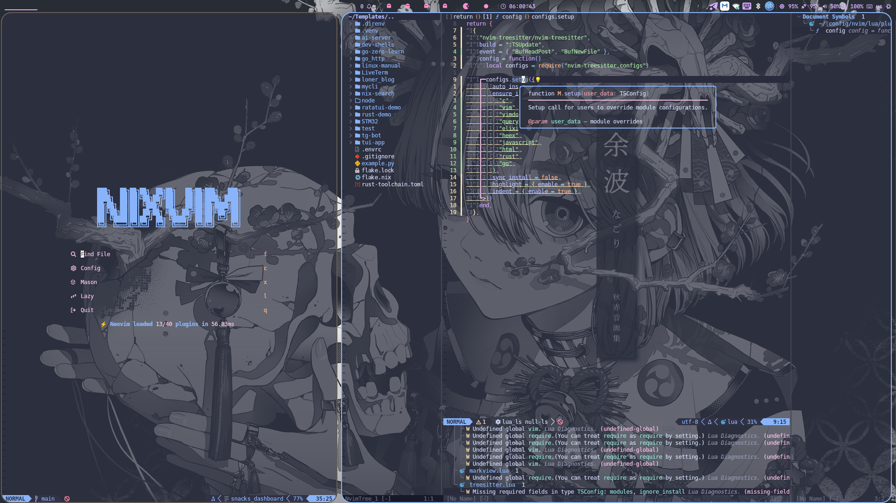

# 🧠 nvim-config

> A modern, modular Neovim configuration powered by [lazy.nvim],
> with full LSP support, Blink completion, Tree-sitter syntax,
> Snacks suite, and Yazi terminal file manager.



## ✨ Features

- ⚙️ Modular plugin loading with `lazy.nvim`
- 🧠 LSP support for **Nix, Lua, Rust, Go, Python, TypeScript/JS, C/C++, Zig, Shell, Racket & Guile** (`nvim-lspconfig`)
- 🐙 Git UI via `neogit` + `gitsigns`
- 🧹 Formatting via `conform.nvim` — stylua, nixfmt, gofumpt, ruff, rustfmt, clang-format, shfmt, zigfmt, taplo, prettier(d), sql-formatter, xmlformatter, raco_fmt, schemat + LSP fallback
- 🔍 Fast picker & file management (`snacks.picker`, `fzf-lua`, `yazi.nvim`)
- 🎨 Beautiful UI with Nerd Font, `noice.nvim`, and `catppuccin` colorscheme
- 📝 Modern completion powered by `blink.cmp` & Windsurf AI (Codeium)
- 📋 Smart Keybinding hints (`which-key`)

## 🧰 Requirements

- [Neovim](https://neovim.io/) **>= 0.11** (uses `vim.lsp.config` / `vim.lsp.enable`)
- [`nixd`](https://github.com/nix-community/nixd) / [`nixfmt`](https://github.com/nix-community/nixfmt)
- [Yazi](https://github.com/sxyazi/yazi)
- [Nerd Font](https://www.nerdfonts.com/)
- [`git`](https://git-scm.com/) — required by `neogit` & `gitsigns`
- [`ripgrep`](https://github.com/BurntSushi/ripgrep) — for `snacks.picker` / `fzf-lua` grep
- A C compiler (`gcc` or `clang`) — for Tree-sitter parser builds
- `node` / `npm` — for `prettierd`, `prettier`, `vtsls`

## 🚀 Installation

```bash
git clone https://github.com/lonerOrz/nvim-config.git ~/.config/nvim
nvim
```

Upon initial launch, `lazy.nvim` installs all plugins pinned in `lazy-lock.json`. You can inspect system health using:

```vim
:checkhealth
```

## 🔌 Plugin Categories

- **Plugin management**: `lazy.nvim`
- **UI & Dashboard**: `catppuccin`, `lualine`, `noice.nvim`, `snacks.nvim`, `which-key.nvim`
- **LSP & Formatting**: `nvim-lspconfig`, `mason-org/mason.nvim`, `lspsaga.nvim`, `conform.nvim`, `lazydev.nvim`, `trouble.nvim`
- **Completion & AI**: `blink.cmp`, `windsurf.nvim`
- **Fuzzy Finding & Tools**: `snacks.picker`, `fzf-lua`, `yazi.nvim`
- **Git & Diff**: `neogit`, `gitsigns.nvim`
- **Productivity**: `markview.nvim`, `flash.nvim`, `compile-mode.nvim`

## 🎹 Key Bindings Summary

Keymaps follow a **prefix semantics + mnemonic suffix** convention:

| Prefix       | Scope                       |
| ------------ | --------------------------- |
| `<leader>a`  | AI & Agent                  |
| `<leader>b`  | Buffer tools                |
| `<leader>c`  | Code & Refactor             |
| `<leader>j`  | Jump & Motion (`flash`)     |
| `<leader>g`  | Git (`neogit` + `gitsigns`) |
| `<leader>m`  | Markdown                    |
| `<leader>n`  | Notifications               |
| `<leader>r`  | Scheme REPL                 |
| `<leader>s`  | Search & Find               |
| `<leader>t`  | Toggles & UI                |
| `<leader>tp` | Profiler                    |
| `<leader>u`  | Utilities                   |
| `<leader>y`  | Yazi file manager           |
| `<leader>o`  | Org mode                    |
| `<leader>z`  | Zen mode                    |

Full keymaps are interactively available via `which-key` (press `<leader>` and wait briefly).

## 📁 Project Structure

```txt
.
├── init.lua               # Entry point & environment setup
├── lazy-lock.json         # Plugin lockfile
├── lua/
│   ├── theme/             # Colorscheme palette system
│   ├── config/            # Core settings, keymaps, lazy setup
│   ├── lang/              # LSP & language-specific configurations
│   └── plugins/           # Plugin modules
```

## 📄 License

This project is licensed under the [MIT License](LICENSE).

## 🔗 Links

- GitHub: [https://github.com/lonerOrz/nvim-config](https://github.com/lonerOrz/nvim-config)
- Fonts: [https://www.nerdfonts.com](https://www.nerdfonts.com)
- Colorscheme: [catppuccin/nvim](https://github.com/catppuccin/nvim)
